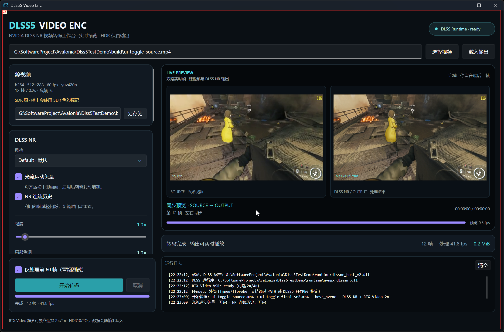
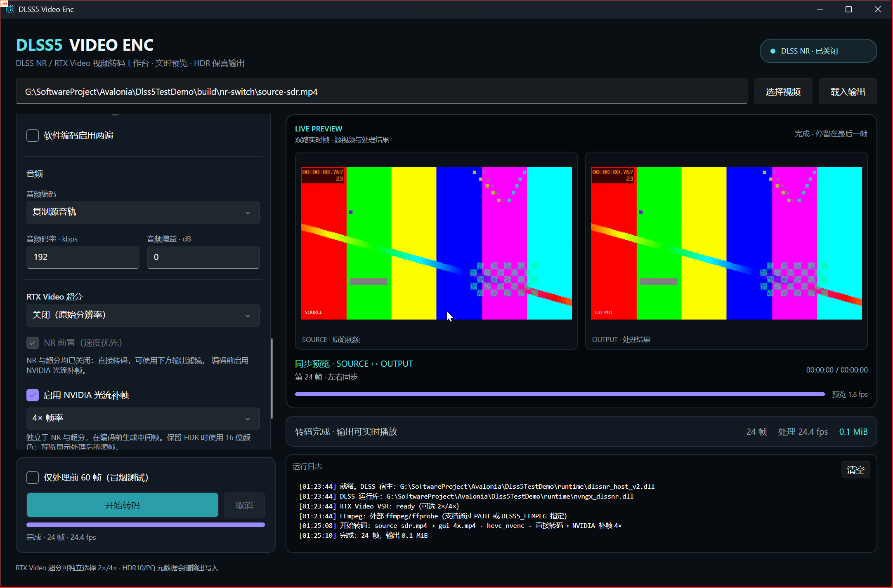
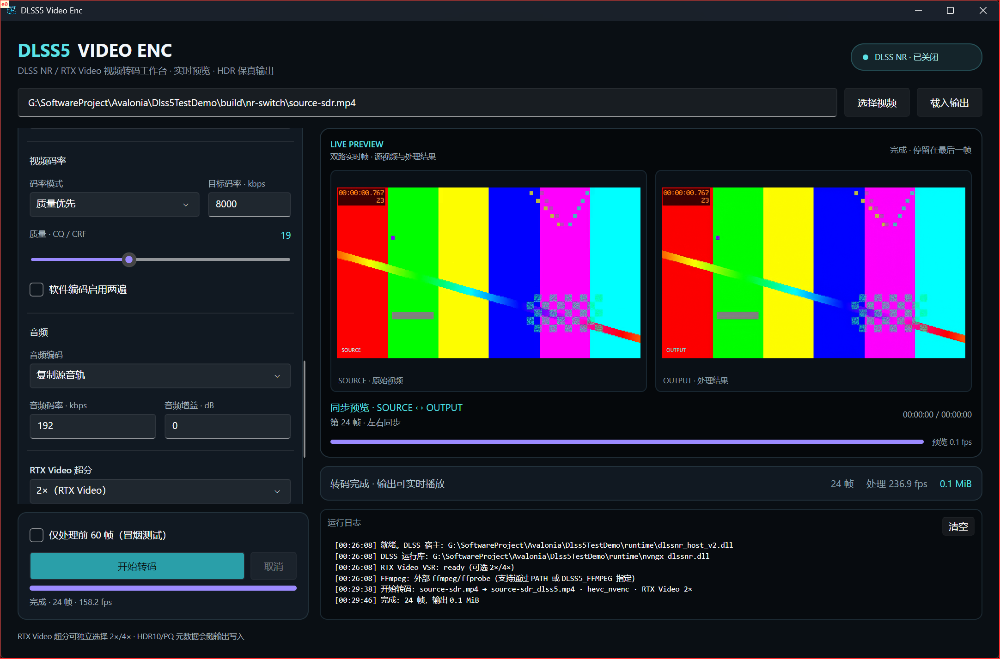
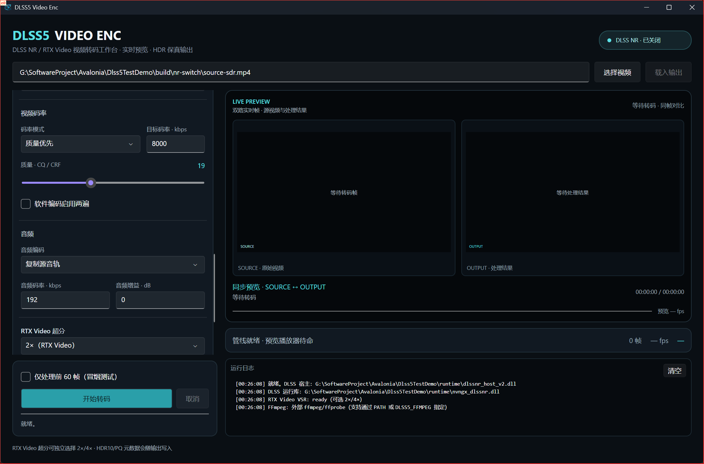

**English** | [**中文**](README.md)

<div align="center">
  

  <h1>Dlss5VideoEnc</h1>

  <h3>NVIDIA DLSS NR / RTX Video Transcoding Workbench</h3>

  <h4>
    A Windows desktop transcoder built with Avalonia 12 + FluentAvalonia<br>
    Optional DLSS NR denoising → optional RTX Video super resolution (2× / 4×) → optional optical-flow / RIFE interpolation (2× / 4× / 6×) → FFmpeg encoding, with HDR and a live side-by-side preview
  </h4>
  <div>
    <a href="https://github.com/Johnwikix/Dlss5VideoEnc/releases/latest"></a>
    
    
    
    
    
    
    
  </div>

  <div>
    <a href="https://github.com/Johnwikix/Dlss5VideoEnc"></a>
    
    
    
  </div>

  <br>

</div>

<br>

## 📥 Download & Install

<div align="center">

| [ZIP / folder release](https://github.com/Johnwikix/Dlss5VideoEnc/releases/latest) | [MSIX package](https://github.com/Johnwikix/Dlss5VideoEnc/releases/latest) |
| :---: | :---: |
| Portable, ships .NET, FFmpeg, NR / VSR runtimes and RIFE models; logs and settings live next to the app, redirectable with `DLSS5_DATA_DIR` | The exact same payload, installable with `Add-AppxPackage` after signing; data is redirected to the MSIX private LocalCache |

</div>

Both editions are produced by `tools\package.ps1` as a complete `win-x64` payload in a timestamped `dist\` folder. If no prebuilt package is published, follow the Build section below. NVIDIA runtimes, FFmpeg shared libraries and ONNX models under `runtime\` are large and license-restricted, so **they are not tracked in Git** — fetch them as described in "Runtime & Model Preparation".

DLSS NR, RTX Video VSR and NVIDIA optical-flow interpolation all require an **NVIDIA RTX GPU**; AMD / Intel support is limited to FFmpeg AMF / QSV encoding, and the OpenDLSS-NR backend is not integrated. Unsigned MSIX packages cannot be installed: use `-CreateTestCertificate`, import the `.cer` into Trusted Root Certification Authorities, then install.

<br>

## 🌟 Features

### 🎬 Video Transcoding & Encoding

- 🎞️ **Codecs & containers**: `hevc_nvenc` by default, plus `h264_nvenc` / `av1_nvenc`, software `libx264` / `libx265` / `libsvtav1` / `libvpx-vp9`, and AMD AMF / Intel QSV backends. Audio can be copied or re-encoded with bitrate and gain controls; two-pass encoding and software fallbacks are supported
- 🧩 **NVDEC hardware decode**: Auto (NVDEC first), forced NVDEC, and CPU software decode, shared by the GUI, CLI and batch entry points. Auto is the default; the CLI uses `--decoder auto|nvdec|cpu` and `--decode-device 0` to pick a CUDA device. NVDEC is reported as confirmed only after the first CUDA hardware surface arrives; the host path is confirmed after a successful readback. On first-frame initialization failure, Auto restarts from the beginning in software; after frames have been delivered it stops instead of mixing the timing history of two backends
- 🌈 **End-to-end HDR**: HDR sources decode through zscale to RGBA16F, NR and history accumulation keep floating-point pixels, VSR uses 10-bit RGB textures and outputs RGBA16F, and the result is converted back to 10-bit RGBA for the encoder. PQ / HLG / AV1 HDR are all verified
- 🔒 **Output protection**: input / output paths are session-only and never persisted; changing the source regenerates the output name, and existing files or folders get `_1`, `_2` suffixes. Core atomically reserves a new filename before encoding and keeps ownership, so concurrent jobs targeting the same path cannot overwrite existing content
- 🖥️ **Live comparison preview**: source and processed frames stay side by side, with live progress, speed, frame counts and logs. The completion state also shows the post-interpolation frame count; generated frames are not played back in the preview

The NVDEC path follows `little-fancy-tool-ava`'s hybrid approach, keeping the compatibility frame interface and HDR color conversion for NR / VSR. The compatibility path still reads hardware frames back, converts color on the CPU and uploads again, while the SDR RIFE combination can connect NVDEC, NR, RTX Video and NVENC through shared GPU memory. **RTX 5070 Ti / driver 617.14 has been verified at 4K/8K for SDR, PQ, HLG and AV1 HDR; NVDEC and software decode produce identical RGBA pixels.** Independent toggle combinations, cancel/restart, software two-pass, and a published-package NVDEC → NR → RTX Video 4K→8K → PQ interpolation run were also verified. See the [NVDEC integration record](docs/NVDEC_DECODING.md) for boundaries, the short-clip matrix and decode-stage CPU timings.

### 🧠 DLSS NR Denoising & Temporal Stability

By default a transcode keeps the NR session's continuous history and estimates motion vectors from the current frame to the previous one with the NVIDIA Optical Flow API. The vectors feed NR and align the output-correction history. NR runs at source resolution by default (before super resolution), so vectors and NR input share the same coordinate system.

Anti-flicker accumulation stores the signed correction "NR output − NR input" and adds it back to the current input. Local color mismatch, motion boundaries, out-of-bounds and invalid pixels, and scene cuts reject stale history; scene cuts also reset NR and optical-flow history. History decay follows the source frame rate, and preview and encoding use the same processed result; HDR uses floating-point corrections.

- ⚡ **CUDA GPU temporal processing**: with optical flow enabled on SDR, grayscale conversion, motion-vector expansion, confidence filtering and correction accumulation run on CUDA by default, while NVOFA estimates the flow. NR and CUDA share D3D12 buffers without reading motion fields or history planes back; the current compatibility decode / SR / encode interfaces still pass host frames, so the GPU stages read back only a 4-byte scene-cut flag and the final frame. HDR, disabled optical flow, older hosts or unavailable interop keep the original path; `DlssNrOptions.UseGpuTemporalProcessing = false` / `--gpu-temporal 0` provides an A/B comparison
- 🎛️ **Independent toggles**: the GUI's "Optical flow motion vectors" and "NR continuous history" are checked by default and persisted. Disabling optical flow keeps static-region accumulation; disabling continuous history resets NR every frame and stops correction accumulation. Core exposes `MotionGuidance`, `ContinuousHistory` and `TemporalStabilization` separately. "Fine motion matching" (`FineMotion` / `--fine-motion 1`) requests a finer grid, is off by default, and falls back automatically when unsupported. To compare against the original zero-motion path use `--temporal 0 --motion-guidance 0`
- 📐 **Parameter limits**: intensity, local tone, local structure and skin structure are clamped to 0–5× (0.1 steps in the UI); legacy settings and out-of-range CLI values are clamped too, and non-finite values fall back to defaults. Local parameters at 20× produce colored artifacts in the model output
- 🔍 **Fallbacks & limits**: when the optical-flow interface is unavailable or does not support the input size, static-region accumulation is used automatically and the actual path is reported in the log. This processing adds transcode time and reduces flicker, but wrong flow and scenes without real depth can still show residual artifacts

The approach follows [Magpie's temporal stabilization](https://github.com/SAOG0721/Magpie/blob/experimental/src/Magpie.Core/DLSSNRTemporal.cpp); see the [NR temporal fix](docs/DLSSNR_TEMPORAL_FIX.md), [GPU temporal report](docs/GPU_TEMPORAL_2026-10-25.md) and [strength & motion fix record](docs/NR_STRENGTH_AND_MOTION.md).

### 🔍 RTX Video Super Resolution

- 🔀 **NR can be disabled independently**: unchecking "Enable DLSS NR" skips NR, optical flow and history accumulation, and does not load the NR host or runtime. RTX Video 2×/4× remains available; with both off the app just transcodes. The toggle is persisted and legacy settings default to on. The CLI and packaged batch entry point accept `--nr 0 --sr 2` (`--nr 1` re-enables NR)
- 🧱 **SDK backend**: the driver D3D11 interface has not been validated as equivalent to the SDK path. On driver 617.14, 1800p/4K inputs silently fall back to ordinary scaling through the driver interface while the SDK handles them correctly, so the SDK backend is retained. See the [driver interface investigation](docs/RTX_VIDEO_DRIVER_INVESTIGATION.md) for experiments and pixel comparisons
- 📦 **Optional runtime components**: 2×/4× require RTX Video SDK 1.1 (or a compatible version), the SDK root in `NV_RTX_VIDEO_SDK`, and `native\vsr_host\build.bat` from the repository root to produce `runtime\vsr_host.dll` and the licensed `runtime\nvngx_vsr.dll`. Without them the Off mode still works, and choosing 2×/4× reports a clear error when a transcode starts
- 🔁 **Processing order**: "NR first (speed priority)" is checked by default and persisted: `source → optical flow / input validation → DLSS NR → history accumulation → (optional) RTX Video 2×/4× → encode`. Unchecking it switches to super resolution → NR, so NR runs at the upscaled resolution for quality-focused comparisons. With super resolution off the order toggle is disabled but its choice is retained
- 🚀 **GPU-resident encoding**: the default NR → VSR → NVENC path keeps the upscaled output in GPU memory, converts it to NV12 through a shared texture and hands it to the encoder, avoiding a full-frame readback and re-upload; previews read back a downscaled image on demand. Compressed video first writes a temporary NUT, then remuxes losslessly and merges audio; the temp file is cleaned on completion or cancellation. This requires the optional `runtime\vsr_encoder.dll` and matching FFmpeg shared libraries — see the [RTX Video SDK setup](tools/RTX_VIDEO_SDK.md). GPU-resident encoding is SDR-only; HDR, software encoding, CPU filters and SR-first configurations use the original frame transport. `--sr-gpu-encode 0` / `UseGpuVsrEncoding` disables it

### ⚡ Frame Interpolation & the GPU Pipeline

The GUI offers **NVIDIA Vulkan optical flow**, **RIFE 4.25 Lite** and **RIFE 4.25** at 2× / 4× / 6×, combinable with NR and RTX Video in any on/off configuration. While enabled, the normal frame-rate setting is suspended and restored afterwards. Interpolation runs after NR / SR and before final output-space filters and encoding. Vulkan prefers linear images to reduce readback cost and probes the original layout when unsupported; avoid downscaling before interpolation.

- 🛰️ **NVIDIA optical flow (`fruc_vulkan`)**: reuses `little-fancy-tool-ava`'s `VK_NV_optical_flow` backend, is off by default, and requires an FFmpeg master build carrying `fruc_vulkan`; the standalone NvOFFRUC SDK is not part of this path. The filter is called in-process through DLLs, while compatibility steps such as decode and muxing still use the FFmpeg EXE. RTX 5070 Ti / 617.14 has been verified at native 3840×2160 and 7680×4320 for SDR / PQ / HLG, plus NR + RTX Video 4K→8K + PQ interpolation. HDR interpolation uses full 16-bit color and outputs HEVC / AV1 10-bit; H.264 / GIF are rejected when HDR is preserved. See the [interpolation validation record](docs/NVIDIA_VULKAN_INTERPOLATION.md)
- 🤖 **RIFE 4.25**: requires Windows 11 24H2+, an NVIDIA GPU, and the NVIDIA TensorRT RTX provider of Windows ML (which may be installed on first use). SDR input / output only, up to 3840×2160. Choose Vulkan for HDR — RIFE never silently drops HDR color information; forcing HDR is skipped and logged when RIFE is selected
- 🧬 **GPU-resident frame pipeline (on by default)**: for SDR, 8-bit YUV420 / NV12, NVDEC, NVENC and no CPU filters, pixels travel `NVDEC → optional NR → optional RTX Video → CUDA RIFE → NVENC`, also supporting super resolution before NR. NR requires optical flow and GPU history processing; VSR stays in a separate process but exchanges frames through shared GPU buffers. Decoding uses a dedicated CUDA stream with five bounded ordered slots, previews read back only a downscaled image, and scene-cut detection reads back only a flag. `--gpu-enhancement 0` disables just the NR / SR GPU handoff for an A/B comparison; `--gpu-frames 0` disables the entire GPU interpolation pipeline. CPU filters, software encoding, software two-pass, unsupported formats or unavailable interop keep the compatibility path. GPU decode color conversion differs slightly from the compatibility swscale path in rounding and chroma resampling — see the [RIFE GPU handoff report](docs/GPU_RIFE_CHAIN_2026-10-25.md)
- ♻️ **Session & tensor reuse**: a single task gate owns the full resource lifecycle. One RIFE session per model and inference size is reused across consecutive jobs without sharing video timing history, and is released on model / size changes, disabling RIFE, failure, cancellation or app shutdown. Applications embedding Core should call `DlssVideoPipeline.ReleaseGpuResources()` on exit. RIFE prepares the image tensor once per input pair — 4×/6× only update each generated frame's time parameter. Static frames, scene cuts and tail frames reuse immutable NV12 data, and redundant scaling is skipped when the output resolution already matches
- 📈 **Counting convention**: source and output frame counts differ — divide 4× output fps by 4 to get the source-frame processing rate. Measurements, quality differences and limits are in the [2026-10-18 GPU pipeline report](docs/INTERPOLATION_GPU_2026-10-18.md) and the [combined performance record](docs/PERFORMANCE_NR_VERSIONS_2026-10-25.md); model provenance and SHA256 hashes are in the [RIFE model notes](docs/RIFE_MODELS.md)

### 🌈 Forced HDR10 Output

Selecting "Force HDR10 / PQ" for an SDR source performs real mapping through NVIDIA driver RTX Video HDR: `SDR decode → NR / super resolution → optional Vulkan interpolation → driver TrueHDR → BT.2020/PQ RGB→YUV → 10-bit encode`. Generated and tail frames are mapped too. HEVC / AV1 / VP9 10-bit are supported; H.264 / GIF are rejected. HDR sources keep the existing PQ / HLG path.

The driver interface needs no RTX Video SDK but requires a TrueHDR-capable NVIDIA RTX GPU / driver and this project's native host. `native\vsr_host\build-hdr.bat` (also run by `build.bat`) produces `runtime\driver_hdr_host.dll`, which the packaging script ships. Unsupported initialization or frame failures raise explicit errors, and the preview keeps showing the SDR frame stage. See the [driver HDR integration record](docs/SMOOTH_MOTION_RTX_HDR.md) for the implementation, color conventions and validation.

### 🗃️ DLSS NR Runtime & Model Preset

The GUI's "NR Version" list recursively discovers `nvngx_dlssnr*.dll` under `runtime\` and `mods\`, displaying the PE numeric version and a folder label, with **no version whitelist**. An explicit choice is saved as a relative-path ID, so refreshing, restarting or moving the whole release folder cannot select the wrong version due to reordering. If a saved ID is no longer in the scan results, a "Missing · <old ID>" placeholder is inserted and kept selected rather than silently switching; starting a job with it prompts for a new choice and refuses to start.

The "NR Model Preset" is a hint inside the same DLL, not another file: `0 auto / 1 A (legacy model) / 2 B (lightweight model)`, passed to the host through `dlssnr_set_options`, `dlssnr_init` and `dlssnr_create_feature`. **A** is the default; legacy `auto` settings migrate to A once on upgrade. Auto selects B on 310.9.16, while A keeps the 310.8 model behavior; 310.8 has only the legacy model, so choosing B does not add one. Changing the preset rebuilds the NR session, hence "applies on the next queue start" — it cannot be switched mid-run. The CLI and app `--autorun` use `--nr-preset auto|a|b`.

The "Auto" resolution chain stops at the first hit: `DLSS5_NR_RUNTIME_DLL` → `mods` override → `DLSS5_GPU_SERIES` folder → **root active version `runtime\nvngx_dlssnr.dll`** → generation-matched `nr\` variants (only when the root file is absent) → the lowest version under `nr\`. Generation matching identifies the RTX 20/30/40/50 generation from the NVIDIA adapter with the most VRAM (by PCI device ID range), considers only folders whose names declare support for that generation, and prefers **lower versions** (unknown versions last). With NR disabled no DLL is resolved or loaded.

**Every version can complete a full transcode.** A former driver-level deadlock (EvaluateFeature followed by NGX teardown on the same calling thread hung the process and left output unfinished) is fixed in the `dlssnr_host_v2.dll` host: teardown moved to a worker thread with a 3-second watchdog. In the rare case the watchdog gives up, later NR sessions in the same process report an explicit error (restart the app); completed output is unaffected, and deep `nr\` paths are no longer restricted.

**Current layout (trimmed 2026-11-14)**: an RTX 50 GPU was verified to run community-patched DLLs originally labeled for RTX 20/30, so NVIDIA originals and RTX 50-only DLLs were removed. Only two community builds remain in `runtime`:

| Location | Version & origin | Bytes | SHA-256 |
| :--- | :--- | ---: | :--- |
| Root active version `runtime\nvngx_dlssnr.dll` | 310.8.2.0 (version string `310.8.SF.0`), SF-v2 FP16-compatible community build, originally labeled RTX 20/30 | 165,830,144 | `6EB209E764F39872625DEBD6ABAF45E2BB6322F6F270F781F70C059AE30B3927` |
| `runtime\nr\Community-Patched-310.9.16-RTX20-RTX30-RTX40-Series\nvngx_dlssnr.dll` | 310.9.16.0 community patch, originally labeled RTX 20/30/40 | 276,162,560 | `A8A237A967469C455A84654932B513AB656FBAA1E0C44504B1E1BF0890F902B8` |

`runtime\NR_OPTIONS_README.txt` is the original 310.8 options-package note, kept for provenance; the three folders it describes no longer exist. The removed RTX 50-only 310.9.16 original can still be extracted from `H:\download\DLSSNR-DLL-Options.zip`; the local backups of the 310.8.0.0 NVIDIA original and the 310.8.0 RTX 40/50 community build (including `download\50.zip`) were deleted and must be downloaded again. Old DLL copies in `dist/`, `.qa/`, `artifacts/`, `src/**/bin` and `packaging/` were also removed by hash, so those historical packages no longer carry a usable root active DLL — regenerate them with the packaging scripts. Paths such as `NVIDIA-Original-310.9.16-RTX50-Series-Only/...` in older validation reports are dead; their measurements apply only to the DLLs of that time, and replacing them with the community builds above may change output and performance.

### ⌨️ Command Line (CLI)

`src/Dlss5Demo.Cli` shares `Dlss5Demo.Core` with the GUI. Positional arguments are inputs (files or folders; folders expand supported video extensions); outputs use `--output` (single input) or `--output-dir` (multiple inputs, defaulting to each source folder) with automatic naming. Every flag takes one value. Switches cover NR strength and temporal options, decode mode, super resolution and order, interpolation backend and multiplier, the GPU pipeline, HDR output, encoder and quality, preview, frame limits, and NR runtime / preset.

```powershell
# NR + 2x super resolution + automatic decode
dotnet run --project src/Dlss5Demo.Cli -c Release -- input.mp4 --output output.mp4 --nr 1 --sr 2 --decoder auto

# Standalone 2x optical-flow interpolation (add --nr 1, --sr 2 to combine NR / SR)
dotnet run --project src/Dlss5Demo.Cli -c Release -- input.mp4 output.mp4 --nr 0 --interpolate 1 --interpolation-multiplier 2

# RIFE 4x interpolation (Lite / Full); compare against the host-frame path
dotnet run --project src/Dlss5Demo.Cli -c Release -- input.mp4 output.mp4 --interpolate 1 --interpolation-backend rife --rife-model lite --interpolation-multiplier 4

# Forced HDR10 with an explicit NR runtime and model preset
dotnet run --project src/Dlss5Demo.Cli -c Release -- input.mp4 output-hdr.mp4 --hdr force --nr-runtime 'runtime/nr/Community-Patched-310.9.16-RTX20-RTX30-RTX40-Series/nvngx_dlssnr.dll' --nr-preset a
```

Other comparison switches: `--gpu-temporal 0`, `--motion-guidance 0`, `--continuous-history 0`, `--temporal 0`, `--fine-motion 1`, `--gpu-frames 0`, `--gpu-enhancement 0`, `--sr-gpu-encode 0`, `--nr-before-sr 0`, `--nr-queue 0`, `--preview 0`, `--frames 180`, `--image-format png|jpg`. When embedding Core in another program, call `RtxVideoWorker.TryServe(args)` first at the entry point and end normal startup when it returns `true`; `TranscodeOptions.VsrWorkerExecutablePath` can point to another executable with that entry point. The desktop app, CLI and test runner are already wired up, so no extra worker installation is needed.

### 🖥️ UI & Runtime Management

Window and EXE icons use the same two-tone flat design optimized for small sizes; the vector source and generator are `src/Dlss5Demo.App/Assets/dlss5-video-enc.svg` and `tools\generate-icon.py` (MSIX assets come from `tools\generate-msix-assets.py`, which needs Pillow). The "Open folder" button next to the source reveals it in Explorer; the folder button next to the output reveals the file, or the output folder if it does not exist yet.

To add an NR version yourself, place the DLL at `runtime\nr\<any name>\nvngx_dlssnr.dll` and click "Refresh". Nested folders and `nvngx_dlssnr_<custom>.dll` names are supported; use the folder name to record the target GPU generation and origin, which also distinguishes original and community builds with the same version. **Only folders whose names contain `RTX20/RTX30/RTX40/RTX50` can be chosen by generation matching in "Auto" mode** (for example `Community-Patched-310.9.16-RTX20-RTX30-RTX40-Series`); when the import script preserves an archive's original folder name (such as `SF-v2`), rename it to add the generation marker. The packaging script ships every NR DLL found under `runtime`.

```powershell
.\tools\import-nr-runtimes.ps1 -ArchivePath 'H:\download\DLSSNR-DLL-Options.zip'
```

## 📊 Feature Matrix

| Category | Capability | Description | Algorithm / Implementation | Main Dependency |
| :--- | :--- | :--- | :--- | :--- |
| Decode | NVDEC / software decode | Auto (NVDEC first), forced NVDEC, CPU; full fallback on first-frame failure | FFmpeg hardware frames + CUDA surface readback, no mixed timing history | FFmpeg / NVDEC |
| Denoise | DLSS NR | Intensity, local tone / structure, skin structure at 0–5×; A / B / auto presets | NGX session + dedicated host process | `nvngx_dlssnr.dll` / `dlssnr_host_v2.dll` |
| Temporal | Optical flow & history | Motion-aligned corrections, scene-cut reset, CUDA GPU temporal processing | NVIDIA Optical Flow API + NVOFA + D3D12 / CUDA shared buffers | NVOFA / CUDA |
| Super resolution | RTX Video VSR | Off / 2× / 4×, NR-first or SR-first | RTX Video SDK backend + separate worker process + shared GPU textures | `vsr_host.dll` / `nvngx_vsr.dll` / `vsr_encoder.dll` |
| Interpolation | NVIDIA Vulkan optical flow | 2× / 4× / 6×, SDR and 16-bit HDR, 10-bit output | `fruc_vulkan` / `VK_NV_optical_flow`, in-process DLL calls | Custom FFmpeg / Vulkan |
| Interpolation | RIFE 4.25 Lite / 4.25 | 2× / 4× / 6×, SDR only, up to 3840×2160 | ONNX inference + CUDA tensor reuse | Windows ML / TensorRT RTX |
| Pipeline | GPU-resident frames | NVDEC → NR → VSR → RIFE → NVENC end-to-end | Dedicated CUDA stream + 5 bounded slots + shared GPU buffers | CUDA / NVENC |
| HDR | HDR passthrough & forced HDR10 | PQ / HLG / AV1 HDR; SDR → TrueHDR → BT.2020/PQ 10-bit | RGBA16F floating-point path + driver RTX Video HDR | `driver_hdr_host.dll` |
| Encoding | Multi-backend transcode | NVENC / AMF / QSV / software, two-pass, audio, temporary NUT remux | In-process FFmpeg + external EXE for compatibility steps | FFmpeg.AutoGen / FFmpeg shared |
| Runtime | NR version discovery | Recursive scan, relative-path IDs, generation matching, missing-file warning | `NrRuntimeCatalog` + `NrGpuAutoSelect` | .NET BCL |
| UI | Live side-by-side preview | Source / output frames, progress fps, logs, reveal-in-Explorer | Avalonia 12 + FluentAvalonia 3 | Avalonia / FluentAvaloniaUI |
| Command line | `Dlss5Demo.Cli` | Parametric entry point for every processing capability, sharing Core | Positional inputs + flags that all take values | .NET 10 |
| Publishing | ZIP / MSIX | Same self-contained payload, timestamped `dist\` folder or signed MSIX | `tools\package.ps1` / `tools\package-msix.ps1` | Windows SDK BuildTools |

## 🖼️ Screenshots




From left to right: main window with the DLSS NR panel and live side-by-side preview; NVIDIA optical-flow interpolation and super-resolution settings; encoding quality with 2× RTX Video; and direct transcoding with NR disabled. The UI is currently available in Chinese only.

## 🧱 Architecture

- **Projects**: `Dlss5Demo.Core` (transcode pipeline, NR / VSR / interpolation, runtime discovery, in-process FFmpeg bindings) + `Dlss5Demo.App` (Avalonia UI, assembly name `Dlss5VideoEnc`) + `Dlss5Demo.Cli` (command-line entry point referencing only Core) + `Dlss5Demo.Tests` (CPU regression and GPU validation console). `native\nr_host` / `native\vsr_host` host the C++ hosts, `packaging\Dlss5VideoEnc.Msix` is the WAP packaging project, and `tools\` holds build, import, validation and packaging scripts
- **UI**: Avalonia 12.1.1 desktop + FluentAvalonia 3.0.2 in a dark workbench layout, Serilog 4 file logging (`logs\app-*.log`), with settings and state persisted to `settings.json`
- **Bounded pipeline**: decode, optical flow / input validation, NR, history accumulation, SR and encoding / preview work on different frames, connected by 3–5 fixed buffer slots. Each stage works in frame order, NR's own history and the correction history each have one state owner, and preview and encoding use the same processed result. Caches are bounded but use more memory than the original single-frame loop
- **Separate SR process**: VSR reads and writes frames through shared memory while the control pipe carries only slot numbers and completion flags, avoiding a shared process-level NGX client with NR and preventing SR driver cleanup from blocking the main app. VSR processes frames synchronously, reusing upload buffers, textures and command allocators; an earlier multi-frame queue did not improve throughput in local measurements and was removed
- **GPU handoff**: on the compatibility path NR uses the host's two-frame submission queue so the next upload overlaps the previous GPU work, with all NGX calls issued in order by a single stage thread. The GPU optical-flow / history path keeps NVOFA, NR and correction history in one stage and waits only on relevant streams / fences across API boundaries. Optical flow uses a dedicated CUDA stream and pinned upload buffers to avoid full-context synchronization
- **Native hosts**: `dlssnr_host_v2.dll` (NR + teardown watchdog), `vsr_host.dll` (RTX Video SDK), `vsr_encoder.dll` (GPU-resident color conversion), `driver_hdr_host.dll` (TrueHDR). Matching FFmpeg EXE and DLLs live in the `runtime\` root, `DLSS5_FFMPEG` still takes priority, and the old `runtime\fruc-ffmpeg` folder was removed
- **Stability & performance**: cancellation or a stage failure stops associated processes, waits for stages to exit and then releases buffers; two-pass GPU resources are released after the frame cache is built; HDR preview converts only the pixels needed for display and reuses pooled buffers; Release builds disable initial tiered compilation so per-pixel hot paths use optimized machine code from the first call. `DLSS5_PROFILE=1` logs average milliseconds per frame per stage (parallel stage times must not be added together as total frame time)
- **Publishing**: `tools\package.ps1` produces a `win-x64` folder and ZIP carrying .NET, FFmpeg, NR / VSR runtimes and RIFE models; `tools\package-msix.ps1` reuses the same payload for MSIX. After staging, all PEs are scanned and only **genuinely malformed** 8-byte Authenticode certificate-directory entries are cleared (valid signatures are untouched, and only staged copies are modified) before `SHA256SUMS.txt` is generated. The MSIX install folder is read-only, so logs, settings and ONNX / TensorRT caches are redirected to `%LOCALAPPDATA%\Dlss5VideoEnc`

## 🛠️ Build

### Prerequisites

- [.NET 10 SDK](https://dotnet.microsoft.com/) and Windows 10 19041 or later (RIFE requires Windows 11 24H2+)
- An NVIDIA RTX GPU with a recent driver; DLSS NR / VSR / NVIDIA optical-flow interpolation cannot be substituted with AMD / Intel
- A custom FFmpeg master build with the `fruc_vulkan` filter (`tools\prepare-ffmpeg.ps1` downloads and verifies a pinned version), plus matching FFmpeg shared libraries and license files
- Optional: RTX Video SDK 1.1 (`NV_RTX_VIDEO_SDK`) for 2×/4× super resolution and TrueHDR; VS 2026 and Windows SDK BuildTools (`makeappx.exe` / `signtool.exe`) for MSIX
- PowerShell 5.1 / 7. `tools\*.ps1` contains Chinese comments and strings, so scripts invoked by WinPS 5.1 **must be saved as UTF-8 with BOM**
- Python + Pillow (only needed to regenerate icons / MSIX assets)

### Runtime & Model Preparation

```powershell
# Pinned FFmpeg EXE and DLLs into the runtime root (or pass -ArchivePath for an already downloaded ZIP)
.\tools\prepare-ffmpeg.ps1
# Two verified RIFE ONNX models into the runtime root
.\tools\prepare-rife-models.ps1
# Optional: VSR and TrueHDR hosts (set NV_RTX_VIDEO_SDK first)
$env:NV_RTX_VIDEO_SDK = 'G:\SDK\RTX_Video_SDK'
native\vsr_host\build.bat
native\vsr_host\build-hdr.bat
```

`build.bat` produces `runtime\vsr_host.dll` and the licensed `runtime\nvngx_vsr.dll`; `build-hdr.bat` produces `runtime\driver_hdr_host.dll`. Place or import the DLSS NR runtime yourself: `tools\import-nr-runtimes.ps1 -ArchivePath <package.zip>`. See "DLSS NR Runtime & Model Preset" above for the current layout.

### Build from Source

```bash
dotnet build Dlss5VideoEnc.sln -c Release
dotnet run --project src/Dlss5Demo.App -c Release
dotnet run --project src/Dlss5Demo.Cli -c Release -- input.mp4 --output output.mp4 --nr 1 --sr 2
```

When `dotnet build` cannot find VS's DesktopBridge targets, the WAP project imports `Msix.NoDesktopBridge.targets`, provides empty targets, skips packaging and emits `NU1503` (NuGet skipping WAP restore) — expected for command-line builds and absent in VS. To actually produce an MSIX use `tools\package-msix.ps1` or VS's `MSBuild.exe`; `dotnet build` cannot replace it for `.wapproj`.

### Debug Run & Regression

```powershell
# 28 CPU regressions and automatic NR runtime detection
dotnet run --project tests/Dlss5Demo.Tests -c Release
dotnet run --project tests/Dlss5Demo.Tests -c Release -- --detect
# RTX GPU checks: flow direction / units, HDR to SDR session switching
dotnet run --project tests/Dlss5Demo.Tests -c Release -- --gpu
# Real NR flicker comparison on a fixed input / correction changes over the first 300 frames of three clips
dotnet run --project tests/Dlss5Demo.Tests -c Release -- --gpu-flicker "input.mp4"
dotnet run --project tests/Dlss5Demo.Tests -c Release -- --compare-video "source.mp4" "before.mp4" "after.mp4"
# Per-stage profiling and real pipeline regressions (input needs at least 12 frames)
$env:DLSS5_PROFILE = '1'
dotnet run --project tests/Dlss5Demo.Tests -c Release -- --pipeline "short.mp4"
dotnet run --project tests/Dlss5Demo.Tests -c Release -- --vsr-transport "short.mp4"
dotnet run --project tests/Dlss5Demo.Tests -c Release -- --nr-switch "short.mp4"
# Standalone NR benchmark
dotnet run --project tests/Dlss5Demo.Tests -c Release -- --nr-benchmark "input.mp4"
```

### Publishing & Distribution

```powershell
# ZIP / folder release: carries .NET, FFmpeg, DLSS NR and RTX Video VSR runtimes
.\tools\package.ps1 -FfmpegDirectory G:\Tool\ffmpeg\bin
# One-shot command-line MSIX (makeappx.exe comes from Microsoft.Windows.SDK.BuildTools or the Windows SDK)
pwsh -NoProfile -File .\tools\package-msix.ps1 -FfmpegDirectory G:\Tool\ffmpeg\bin -Version 0.1.0.0
# Create a local test certificate matching the manifest Publisher and sign (valid on this machine only)
pwsh -NoProfile -File .\tools\package-msix.ps1 -FfmpegDirectory G:\Tool\ffmpeg\bin -CreateTestCertificate
```

`package.ps1` writes a timestamped folder under `dist\` containing a self-contained `win-x64` release and a ZIP; add `-NoRestore` if `win-x64` dependencies were already restored. It requires the `fruc_vulkan` filter and verifies RIFE model hashes, FFmpeg shared-library uniqueness and license files. The MSIX artifact is `dist\Dlss5VideoEnc_<version>_x64.msix`, with layout and payload under `artifacts\msix\`; `-SkipStage` reuses the previous payload, `-PayloadDirectory <dir>` points at another staged payload, and `-MakeAppx` overrides the tool path.

Packaging in VS: open `Dlss5VideoEnc.sln`, select `Release|x64` (or `Debug|x64`), right-click `packaging/Dlss5VideoEnc.Msix` → Build → Deploy; setting it as the startup project enables F5. The solution configures both `Build.0` and `Deploy.0` for this project. During a VS build, `StageMsixPayload` calls `tools\package.ps1` to **clear and rebuild** `artifacts\msix\payload`, runs a self-contained publish, and copies `runtime\`, FFmpeg and licenses, so every build carries the latest code. It uses the system's Windows PowerShell 5.1 by default and does not depend on `pwsh` in PATH. Without a custom `fruc_vulkan` FFmpeg, VS deployment relaxes that check with a warning (local debugging only — interpolation is unavailable); for official packages pass `-p:MsixFfmpegDirectory=<custom FFmpeg folder>` or `-p:MsixRequireFrucVulkan=true`.

Available MSBuild properties: `-p:SkipMsixPayloadStage=true`, `-p:MsixFfmpegDirectory=<dir>`, `-p:MsixRequireFrucVulkan=true`, `-p:MsixPowerShell=pwsh`, `-p:MsixEntryPayloadPrefix=<dir>`. Signing requires the manifest `Publisher` `CN=CF259542-70C0-4852-9523-066A80212473` to match the certificate Subject exactly. `PackageCertificateThumbprint` is a machine-local thumbprint; on another machine reselect the certificate in VS's "Create App Packages" wizard (or override with `-p:PackageCertificateThumbprint=<thumbprint>`). `GenerateTemporaryStoreCertificate` is set to `false` so packaging no longer appends one-off certificates to `Cert:\CurrentUser\My`.

> ⚠️ **Known limits**: an MSIX carries every NVIDIA runtime and the RIFE models, so the full staged payload is about 1.5 GB and the compressed MSIX about 1 GB; a normal package has roughly 281 entries. Third-party license terms are governed by `docs\licenses\` and `runtime\LICENSE.txt`.

### Packaging Troubleshooting

- **`DEP1700` / missing `build.appxrecipe`**: the solution lacks the WAP project's `Build.0` configuration, so "Build Solution" skips packaging. Build the WAP project on its own and confirm that its Build checkbox is enabled and the active platform is x64 in Configuration Manager
- **`DEP1000` copying a deleted NR DLL**: staging clears and rebuilds the payload each time, but VS incremental deployment reuses the previous `build.appxrecipe` / `AppX` layout manifest. After deleting or moving an `nvngx_dlssnr.dll` under `runtime`, the stale manifest still lists `payload\runtime\nr\<old folder>\nvngx_dlssnr.dll` and deployment fails with `DirectoryNotFoundException (0x80070003)`. Delete the reproducible caches below, then Clean → Rebuild → Deploy in VS. Command-line packaging is unaffected; `tools\package-msix.ps1 -SkipStage` is a quick way to verify that the payload's `runtime\` contains only existing NR DLLs

  ```powershell
  Remove-Item -Recurse -Force -ErrorAction SilentlyContinue `
    'packaging\Dlss5VideoEnc.Msix\bin\x64\Release\AppX',
    'packaging\Dlss5VideoEnc.Msix\bin\x64\Release\Dlss5VideoEnc.Msix.build.appxrecipe',
    'packaging\Dlss5VideoEnc.Msix\obj\x64\Release\PackageLayout',
    'packaging\Dlss5VideoEnc.Msix\obj\x64\Release\Dlss5VideoEnc.Msix.wapproj.FileListAbsolute.txt'
  ```

  After trimming runtimes, the MSIX app's private `settings.json` may also hold an `NrRuntimeId` pointing at a removed subfolder; the UI then shows "Missing · …". Re-select "Auto" or `runtime` (the current default) in the "NR Version" dropdown
- **`0x800700C1` signing failure**: when VS reports "failed to sign" and the output contains `Done Adding Additional Store`, `SignedCode::Sign returned error: 0x800700C1` (`ERROR_BAD_EXE_FORMAT`) is not a certificate problem — AppxSip found a malformed Authenticode certificate directory in a PE inside the package, common with trimmed third-party DLLs. Re-run `signtool sign /fd SHA256 /sha1 <thumbprint> <package>.msix` with `APPXSIP_LOG=1`; `File has malformed certificate: ...` identifies the file. In this project it was the 310.8.2.0 community SF-v2 DLL (now at `runtime\nvngx_dlssnr.dll`): its Security Directory points past EOF. `tools\package.ps1` now repairs it automatically after staging, so re-run `package.ps1` instead of reusing an old payload with `-SkipStage`
- **PowerShell stage "exited with code 1"**: WinPS 5.1 decodes BOM-less UTF-8 scripts as GBK, producing a syntax error before any line runs. If `artifacts\msix\payload` is unchanged, check that `tools\package.ps1` and `tools\package-msix.ps1` are UTF-8 with BOM
- **Doubled package size / `%3B` garbage paths**: an early version joined several `WapProjPackageFile` item transforms with `;` before calling `GetDirectoryName`, packing every file twice (536 entries / 1.95 GB) and injecting mojibake paths. Now only the first `.exe` item is used and semicolon-containing prefixes raise an error; if the symptom persists, clean the WAP project's `bin\`, `obj\` and `AppPackages\` and rebuild
- **Diagnostic routine**: for MSIX signing failures re-run signtool with `APPXSIP_LOG=1`; `0x800700C1` → malformed PE certificate directory, `0x8007000B` → Publisher and certificate Subject mismatch

## 💖 Dependencies & Credits

### Third-Party Libraries & Components

| Library / Component | Purpose | License |
| :--- | :--- | :--- |
| [Avalonia](https://avaloniaui.net/) | Cross-platform UI framework (12.1.1) | MIT |
| [Avalonia.Desktop](https://avaloniaui.net/) / [Avalonia.Fonts.Inter](https://avaloniaui.net/) | Desktop runtime and Inter font | MIT |
| [FluentAvaloniaUI](https://github.com/amwx/FluentAvalonia) | Fluent Design controls (3.0.2) | MIT |
| [Serilog](https://serilog.net/) / [Serilog.Sinks.File](https://github.com/serilog/serilog-sinks-file) | Structured and file logging | Apache-2.0 |
| [FFmpeg.AutoGen](https://github.com/Ruslan-B/FFmpeg.AutoGen) | .NET bindings for the FFmpeg C API (9.0.1.1) | MIT |
| [Microsoft.Windows.AI.MachineLearning](https://learn.microsoft.com/windows/ai/) | Windows ML / TensorRT RTX provider driving RIFE ONNX inference | See SDK terms |
| [FFmpeg](https://ffmpeg.org/) | Transcoding, muxing and the `fruc_vulkan` filter (EXE + shared libraries shipped with the app, binaries not tracked, fetched by `tools\prepare-ffmpeg.ps1`) | See `runtime\LICENSE.txt` |
| NVIDIA RTX Video SDK 1.1 | RTX Video super resolution and driver TrueHDR (optional, headers / libs checked out locally) | See `docs\licenses\NVIDIA_RTX_Video_SDK_License.pdf` |
| NVIDIA Optical Flow API / NVOFA / CUDA / NVDEC / NVENC | Motion vectors, GPU temporal processing, hardware decode and encode | NVIDIA terms; see `docs\licenses\NVIDIA-Optical-Flow-Headers-LICENSE.txt` |
| [RIFE 4.25](https://github.com/hzwer/Practical-RIFE) | Lite / Full interpolation ONNX models (downloaded on demand and verified) | MIT, see `docs\licenses\RIFE-MIT-LICENSE.txt` |
| NVIDIA DLSS NR runtimes & community patches | Denoising models and `nvngx_dlssnr.dll` (placed locally, not tracked) | NVIDIA / respective distribution terms |
| [little-fancy-tool-ava](https://github.com/Johnwikix/LittleFancyToolAva) | Reference implementation for hybrid NVDEC and the `fruc_vulkan` backend | — |
| [Magpie](https://github.com/SAOG0721/Magpie) | Reference for DLSS NR temporal stabilization | — |

## 📄 License

This repository **does not ship a project-level open-source license file**; confirm usage and redistribution terms with the repository owner. Third-party terms are in `runtime\LICENSE.txt` and `docs\licenses\` (FFmpeg, NVIDIA RTX Video SDK, NVIDIA Optical Flow Headers, RIFE, etc.). DLSS NR runtimes, RTX Video SDK components, FFmpeg binaries and RIFE / ONNX weights are not tracked in Git and must be obtained separately under their own licenses; the packaging scripts ship the corresponding license files with each release.

## 🗂️ Data Storage

- **Preferences & logs**: packaged / MSIX runs redirect to `%LOCALAPPDATA%\Dlss5VideoEnc` (MSIX maps this to the package's private LocalCache); ZIP and development runs write to the program folder and `runtime\`. `DLSS5_DATA_DIR` overrides the location
- **Settings**: `settings.json` stores the NR toggle, temporal options, model preset, NR runtime ID (a relative path), and window / UI choices. Input / output paths are never persisted or restored from legacy settings
- **Logs**: `logs\app-*.log`, with optional per-stage profiling via `DLSS5_PROFILE=1`; `runtime\*.log` are host logs
- **Caches**: ONNX / TensorRT compilation caches follow the data directory; `runtime\Cache\` is Git-ignored
- **Runtimes & models**: NR DLLs, FFmpeg shared libraries, host DLLs and ONNX models under `runtime\` are Git-ignored and must be fetched as described in "Runtime & Model Preparation". Moving the entire release folder does not invalidate saved NR runtime IDs

## 📚 Design & Validation Documents

- **Decode & pipeline**: [NVDEC integration record](docs/NVDEC_DECODING.md), [pipeline performance record](docs/PIPELINE_PERFORMANCE.md), [2026-10-18 GPU pipeline report](docs/INTERPOLATION_GPU_2026-10-18.md), [RIFE GPU handoff report](docs/GPU_RIFE_CHAIN_2026-10-25.md)
- **NR & temporal**: [NR temporal fix](docs/DLSSNR_TEMPORAL_FIX.md), [GPU temporal report](docs/GPU_TEMPORAL_2026-10-25.md), [strength & motion fix](docs/NR_STRENGTH_AND_MOTION.md), [NR version benchmark](docs/NR_VERSION_BENCHMARK_2026-10-25.md), [combined performance & NR version selection](docs/PERFORMANCE_NR_VERSIONS_2026-10-25.md)
- **VSR / HDR / interpolation**: [driver interface investigation](docs/RTX_VIDEO_DRIVER_INVESTIGATION.md), [driver HDR integration](docs/SMOOTH_MOTION_RTX_HDR.md), [interpolation validation record](docs/NVIDIA_VULKAN_INTERPOLATION.md)
- **Models & configuration**: [RIFE model notes](docs/RIFE_MODELS.md), [RTX Video SDK setup](tools/RTX_VIDEO_SDK.md), [changelog](docs/changelogs.md)

> Some reproduction commands in the 2026-10-25 validation reports point at removed paths such as `NVIDIA-Original-310.9.16-RTX50-Series-Only/...`; each report notes this under its title. Those measurements apply only to the DLLs available at the time.

---
