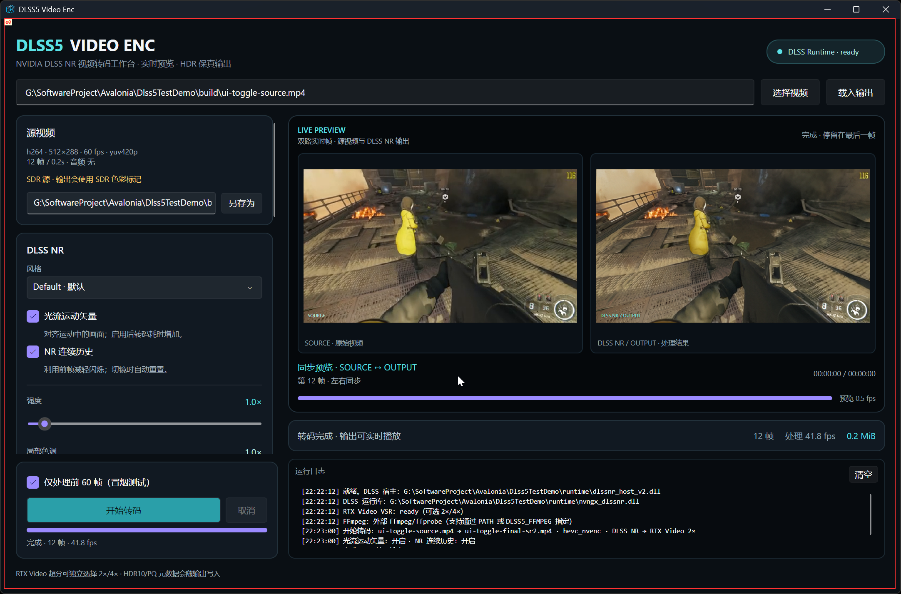
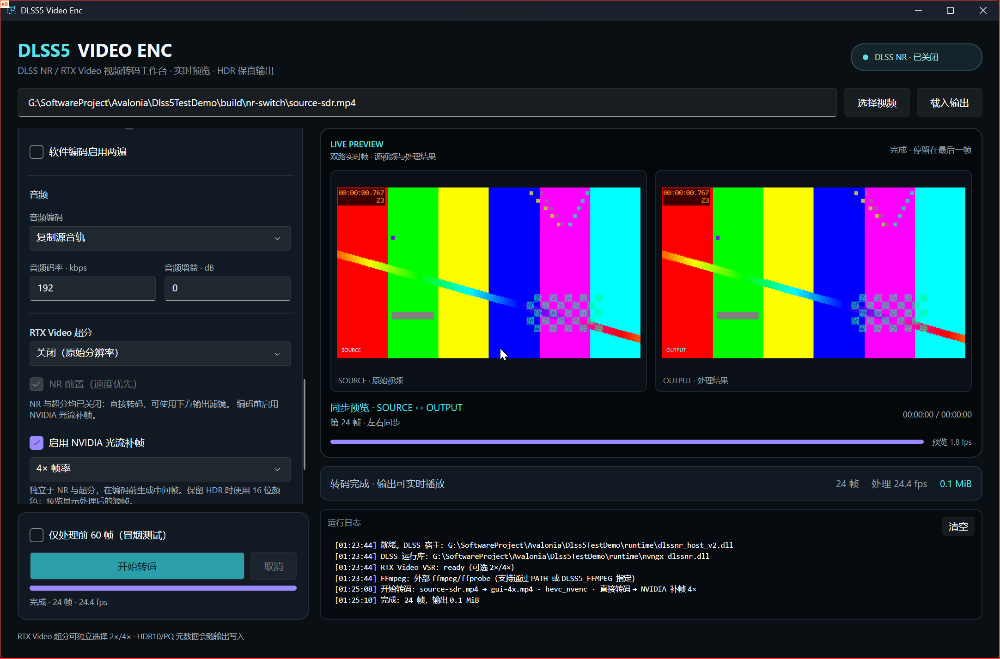
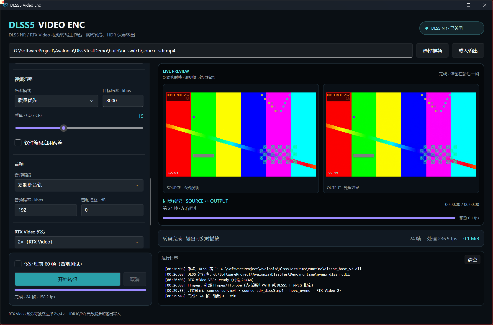
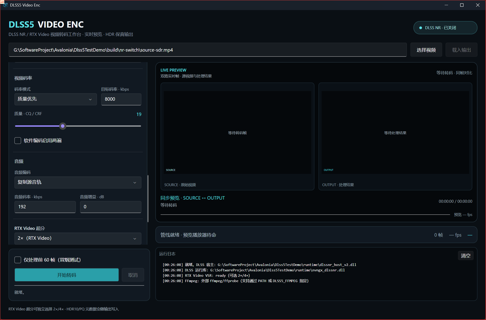

[**English**](README.en.md) | **中文**

<div align="center">
  

  <h1>Dlss5VideoEnc</h1>

  <h3>NVIDIA DLSS NR / RTX Video 视频转码工作台</h3>

  <h4>
    基于 Avalonia 12 + FluentAvalonia 构建的 Windows 桌面转码工具<br>
    可选 DLSS NR 降噪 → 可选 RTX Video 超分（2× / 4×）→ 可选光流 / RIFE 补帧（2× / 4× / 6×）→ FFmpeg 编码，支持 HDR 与实时同步对照预览
  </h4>
  <div>
    <a href="https://github.com/Johnwikix/Dlss5VideoEnc/releases/latest"></a>
    
    
    
    
    
    
    
  </div>

  <div>
    <a href="https://github.com/Johnwikix/Dlss5VideoEnc"></a>
    
    
    
  </div>

  <br>

</div>

<br>

## 📥 下载与安装

<div align="center">

| [ZIP / 目录发布](https://github.com/Johnwikix/Dlss5VideoEnc/releases/latest) | [MSIX 安装包](https://github.com/Johnwikix/Dlss5VideoEnc/releases/latest) |
| :---: | :---: |
| 解压即用，自带 .NET、FFmpeg、NR / VSR 运行库与 RIFE 模型；日志与设置写在程序目录，可用 `DLSS5_DATA_DIR` 重定向 | 与 ZIP 完全相同的负载，需有效签名后 `Add-AppxPackage` 安装；数据重定向到 MSIX 私有 LocalCache |

</div>

两种发布都由 `tools\package.ps1` 生成完整的 `win-x64` 负载，输出到 `dist\` 的时间戳目录；若仓库尚无预编译包，请按下方「构建」章节自行出包。`runtime\` 下的 NVIDIA 运行库、FFmpeg 共享库与 ONNX 模型体积大且受许可约束，**均不入库**，首次构建前需要按「运行库与模型准备」获取。

DLSS NR、RTX Video VSR 与 NVIDIA 光流补帧都要求 **NVIDIA RTX 显卡**；AMD / Intel 支持仅限 FFmpeg AMF / QSV 编码，OpenDLSS-NR 后端未接入。MSIX 包未签名不能直接安装，用 `-CreateTestCertificate` 生成证书并导入「受信任的根证书颁发机构」后再安装。

<br>

## 🌟 核心功能

### 🎬 视频转码与编码

- 🎞️ **编码与容器**：默认 `hevc_nvenc`，支持 `h264_nvenc` / `av1_nvenc` 等 NVENC 编码，软件 `libx264` / `libx265` / `libsvtav1` / `libvpx-vp9`，以及 AMD AMF / Intel QSV 后端；音频可复制或重编码，支持码率、增益、双遍编码与软件编码回退
- 🧩 **NVDEC 硬件解码**：自动（优先 NVDEC）、强制 NVDEC、CPU 软件解码三档，GUI、CLI 与批处理入口共用同一实现。默认自动；CLI 用 `--decoder auto|nvdec|cpu`，`--decode-device 0` 指定 CUDA 设备。实际收到 CUDA 硬件表面的首帧后日志才报告 NVDEC 已确认；主机路径在回读成功后确认。自动模式在首帧初始化失败时重新从头软件解码，已经交付帧后遇到错误则停止，不混用两种后端的时序历史
- 🌈 **HDR 全链路**：HDR 源用 zscale 解码为 RGBA16F，NR 与历史累积保留浮点像素，VSR 使用 10-bit RGB 纹理并输出 RGBA16F，最后转回 10-bit RGBA 交给编码器；PQ / HLG / AV1 HDR 均已实测
- 🔒 **输出保护**：输入 / 输出路径只用于当前会话，不写入设置；更换输入自动重新生成输出名，同名文件或目录追加 `_1`、`_2` 后缀。Core 在编码前原子预留文件名并保持所有权，并发任务使用相同目标也不会覆盖已有内容
- 🖥️ **实时对照预览**：源帧与处理结果同步显示，进度、速度、帧数与日志实时更新；完成状态同时显示补帧后的帧数，预览不播放生成帧

NVDEC 部分参考 `little-fancy-tool-ava` 的混合处理方式，保留 NR / VSR 的兼容帧接口与 HDR 色彩转换。兼容路径仍有硬件帧回读、CPU 色彩转换和上传；SDR RIFE 组合可通过共享显存连接 NVDEC、NR、RTX Video 与 NVENC。**RTX 5070 Ti / 617.14 已实测 4K/8K 的 SDR、PQ、HLG 及 AV1 HDR，NVDEC 与软件解码的 RGBA 像素一致**；独立开关组合、取消重启、软件双遍与发布包中的 NVDEC → NR → RTX Video 4K→8K → PQ 补帧也已验证。实现边界、短片验证矩阵与解码阶段 CPU 耗时对比见 [NVDEC 接入记录](docs/NVDEC_DECODING.md)。

### 🧠 DLSS NR 降噪与时序稳定

视频转换默认保留 NR 会话的连续历史，并用 NVIDIA Optical Flow API 估计当前帧到上一帧的运动向量；向量同时送入 NR，也用于对齐输出修正量的历史。默认 NR 在源分辨率处理、随后超分，运动向量与 NR 输入保持同一坐标系。

抗闪烁累积的是「NR 输出 − NR 输入」的有符号修正量，再加回当前输入。局部颜色不匹配、运动边界、越界、无效像素和切镜会拒绝旧历史；切镜还重置 NR 与光流历史。历史衰减按源视频帧率计算，预览与编码使用同一处理结果；HDR 使用浮点修正量。

- ⚡ **CUDA GPU 时序处理**：SDR 开启光流时，灰度转换、运动矢量展开、置信度过滤和修正量累积默认在 CUDA 执行，光流估计由 NVOFA 专用引擎完成。NR 与 CUDA 共享 D3D12 显存缓冲，不回读运动场或历史平面；当前兼容解码 / SR / 编码接口仍传递主机帧，GPU 阶段只回读 4 字节切镜标志和最终输出帧。HDR、关闭光流、旧宿主或显存互操作不可用时沿用原路径；`DlssNrOptions.UseGpuTemporalProcessing = false` / `--gpu-temporal 0` 可做同配置对照
- 🎛️ **独立开关**：界面「光流运动矢量」「NR 连续历史」默认勾选并随设置保存；关闭光流保留静态区域累积，关闭连续历史则每帧重置 NR 并停止修正量累积。Core 分别用 `MotionGuidance`、`ContinuousHistory`、`TemporalStabilization` 控制；「精细光流匹配」（`FineMotion` / `--fine-motion 1`）可请求更细网格，默认关闭，不支持时自动回退。对照零运动引导路径用 `--temporal 0 --motion-guidance 0`
- 📐 **参数上限**：强度、局部色调、局部结构及皮肤结构统一限制到 0–5×（UI 步长 0.1），旧设置和 CLI 的超限数值同样收敛，非有限数值回退默认值。20× 的局部参数会使模型输出彩色异常
- 🔍 **降级与边界**：光流接口不可用或不支持输入尺寸时自动改用静态区域累积，可在日志确认实际路径；该处理增加转码耗时，可降低闪烁，但错误光流和无真实深度的场景仍可能有残余伪影

思路参考 [Magpie 的时序稳定实现](https://github.com/SAOG0721/Magpie/blob/experimental/src/Magpie.Core/DLSSNRTemporal.cpp)，修复与实现记录见 [NR 时序修复](docs/DLSSNR_TEMPORAL_FIX.md)、[GPU 时序报告](docs/GPU_TEMPORAL_2026-10-25.md) 与 [强度与光流修复记录](docs/NR_STRENGTH_AND_MOTION.md)。

### 🔍 RTX Video Super Resolution

- 🔀 **NR 可独立关闭**：取消「启用 DLSS NR」后跳过 NR、光流和历史累积，也不加载 NR 宿主或运行库；此时仍可选 RTX Video 2×/4×，两者都关闭则直接转码。开关保存到设置，旧设置默认保持开启。CLI 与发布程序批处理入口支持 `--nr 0 --sr 2`（`--nr 1` 恢复 NR）
- 🧱 **SDK 后端**：驱动 D3D11 接口与 SDK 路径未通过等价性验证，本机 617.14 驱动的 1800p/4K 输入会通过驱动接口静默退回普通缩放，SDK 可正常处理，因此保留 SDK 后端；实验与像素对照见 [驱动接口调查](docs/RTX_VIDEO_DRIVER_INVESTIGATION.md)
- 📦 **可选运行组件**：启用 2×/4× 需要安装 RTX Video SDK 1.1（或兼容版本），把 SDK 根目录设为 `NV_RTX_VIDEO_SDK`，再在仓库根目录执行 `native\vsr_host\build.bat` 生成 `runtime\vsr_host.dll` 与授权的 `runtime\nvngx_vsr.dll`。缺少这两个文件时关闭档仍可用，选择 2×/4× 会在启动转码时给出明确错误
- 🔁 **处理顺序**：默认勾选「NR 前置（速度优先）」并保存到设置，顺序为 `源视频 → 光流/输入验证 → DLSS NR → 历史累积 →（可选）RTX Video 2×/4× → 编码`；取消勾选则超分 → NR，NR 在放大后的分辨率处理，用于优先对照视觉质量。关闭超分时顺序开关禁用但保留选择
- 🚀 **显存直编**：默认 NR → VSR → NVENC 路径把超分输出留在显存，经共享纹理在 GPU 上转成 NV12 交给编码器，省去整帧回读与重新上传；预览按需回读缩小画面。压缩视频先写临时 NUT，再无损封装并合入音频，结束 / 取消时清理。需要可选的 `runtime\vsr_encoder.dll` 与匹配 FFmpeg 共享库，构建方法见 [RTX Video SDK 配置](tools/RTX_VIDEO_SDK.md)。GPU 直编限 SDR；HDR、软件编码、CPU 滤镜、SR 前置等不兼容配置沿原帧传输路径，`--sr-gpu-encode 0` / `UseGpuVsrEncoding` 可关闭

### ⚡ 帧率补帧与显存管线

界面可选 **NVIDIA Vulkan 光流**、**RIFE 4.25 Lite**、**RIFE 4.25**，倍率 2× / 4× / 6×，可与 NR、RTX Video 任意组合。启用后普通帧率设置暂停生效，关闭后恢复；补帧在 NR / SR 之后、最终输出空间滤镜与编码之前运行。Vulkan 优先线性图像以降低回读开销，不支持时探测原布局；启用补帧时避免先压缩再补帧。

- 🛰️ **NVIDIA 光流（`fruc_vulkan`）**：沿用 `little-fancy-tool-ava` 的 `VK_NV_optical_flow` 后端，默认关闭，需要带 `fruc_vulkan` 的 FFmpeg master，独立 NvOFFRUC SDK 不参与此路径。光流滤镜在进程内通过 DLL 调用，解码、封装等兼容环节仍用 FFmpeg EXE。RTX 5070 Ti / 617.14 已实测原生 3840×2160、7680×4320 的 SDR / PQ / HLG 及 NR + RTX Video 4K→8K + PQ 补帧；HDR 补帧使用完整 16 位颜色，输出 HEVC / AV1 10-bit，保留 HDR 时不接受 H.264 / GIF。细节见 [补帧验证记录](docs/NVIDIA_VULKAN_INTERPOLATION.md)
- 🤖 **RIFE 4.25**：需要 Windows 11 24H2+、NVIDIA GPU 与 Windows ML 的 NVIDIA TensorRT RTX 提供程序（首次使用可能安装）；仅支持 SDR 输入 / 输出，最大 3840×2160。HDR 请选择 Vulkan，RIFE 不会静默丢弃 HDR 色彩信息；选 RIFE 时跳过强制 HDR 并记录日志
- 🧬 **显存帧管线（默认开启）**：SDR、8 位 YUV420 / NV12、NVDEC、NVENC 且无 CPU 滤镜时，像素沿 `NVDEC → 可选 NR → 可选 RTX Video → CUDA RIFE → NVENC` 传递，也支持先超分再 NR；NR 需启用光流及 GPU 历史处理，VSR 使用独立进程但通过共享 GPU 缓冲交换帧。解码用独立 CUDA 流、5 个有界槽位按序交接，预览只回读缩小画面，切镜判断只回读标志。`--gpu-enhancement 0` 可单独关闭 NR / SR 显存衔接做 A/B 对照，`--gpu-frames 0` 关闭整条显存补帧管线；CPU 滤镜、软件编码、软件双遍、不支持格式或显存接口沿用兼容路径。GPU 解码色彩转换与兼容路径的 swscale 有细微舍入 / 色度重采样差异，见 [RIFE 显存衔接报告](docs/GPU_RIFE_CHAIN_2026-10-25.md)
- ♻️ **会话与张量复用**：单一任务门控制完整资源生命周期；保留一套同模型、同尺寸的 RIFE 会话，连续任务复用初始化但不共享视频时序历史，换模型 / 推理尺寸 / 关闭 RIFE / 失败 / 取消 / 关闭应用时释放。嵌入 Core 的程序应在关闭时调用 `DlssVideoPipeline.ReleaseGpuResources()`。RIFE 每对输入帧只准备一次图像张量，4×/6× 仅更新各生成帧的时间参数；静帧、切镜和尾帧复用不可变 NV12 数据，输出分辨率相同时省略多余缩放
- 📈 **计数口径**：源帧计数与输出帧计数不同，4× 输出 fps 应除以 4 才是源帧处理速度。实测、画质差异与限制见 [2026-10-18 GPU 管线报告](docs/INTERPOLATION_GPU_2026-10-18.md) 与 [组合性能记录](docs/PERFORMANCE_NR_VERSIONS_2026-10-25.md)，模型来源与 SHA256 见 [RIFE 模型说明](docs/RIFE_MODELS.md)

### 🌈 强制 HDR10 输出

SDR 源选择「强制 HDR10 / PQ」后使用 NVIDIA 驱动 RTX Video HDR 做真实映射：`SDR 解码 → NR/超分 → 可选 Vulkan 补帧 → 驱动 TrueHDR → BT.2020/PQ RGB→YUV → 10-bit 编码`。补帧生成帧及尾帧均执行映射，支持 HEVC / AV1 / VP9 10-bit，拒绝 H.264 / GIF；HDR 源继续沿用现有 PQ / HLG 路径。

驱动接口无需 RTX Video SDK，但要求支持 TrueHDR 的 NVIDIA RTX GPU / 驱动与本项目原生宿主。执行 `native\vsr_host\build-hdr.bat`（`build.bat` 也会构建）生成 `runtime\driver_hdr_host.dll`，发布脚本随包携带；初始化不支持或帧处理失败时明确报错，预览继续显示源帧阶段的 SDR 画面。实现、色彩约定与验证见 [驱动 HDR 接入记录](docs/SMOOTH_MOTION_RTX_HDR.md)。

### 🗃️ DLSS NR 运行库与模型预设

界面的「NR 版本」从 `runtime\` 与 `mods\` 递归发现 `nvngx_dlssnr*.dll`，显示 DLL 的 PE 数值版本与目录标签，**没有版本白名单**；明确选择按相对路径作为 ID 保存，刷新、重启、移动整个发布目录都不会因排序变化选错。保存的 ID 不在扫描结果里时显示「已缺失 · <旧 ID>」并保持选中，不静默替换；带着它点开始会提示重新选择并拒绝启动任务。

「NR 模型预设（Preset）」是同一个 DLL 内部的模型提示，不是另一个文件：值只有 `0 自动 / 1 A 旧模型 / 2 B 轻量模型`，经 `dlssnr_set_options`、`dlssnr_init`、`dlssnr_create_feature` 传给宿主。默认 **A**，旧配置的 auto 在升级时一次性迁移为 A；310.9.16 的 auto 选择 B，A 保留 310.8 的模型效果，310.8 只有旧模型，选 B 也不会新增模型。改动 preset 会触发 NR 会话重建，因此「下次开始队列时生效」，运行中无法热切换；CLI 与应用 `--autorun` 用 `--nr-preset auto|a|b`。

「自动」解析链（命中即停）：`DLSS5_NR_RUNTIME_DLL` → `mods` 覆盖 → `DLSS5_GPU_SERIES` 指定目录 → **根目录激活版 `runtime\nvngx_dlssnr.dll`** → 按显卡代际匹配 `nr\` 变体（仅当根目录未放置）→ `nr\` 全场最低版本。代际匹配按显存最大的 NVIDIA 适配器识别 RTX 20/30/40/50（依 PCI 设备号段），只挑目录名声明支持该代际的变体，**版本低者优先**，版本未知排最后；关闭 NR 时不解析或加载所选 DLL。需要并存多个版本时可用 `runtime\30`、`runtime\40`、`runtime\50` 布局并设置 `DLSS5_GPU_SERIES`。

**全部版本均可完整转码**：曾存在的驱动层死锁（同一调用线程先 EvaluateFeature 再做 NGX teardown 时挂起）已在宿主 `dlssnr_host_v2.dll` 修复——teardown 移到工作线程并带 3 秒看门狗；极少数看门狗放弃清理时，同进程后续 NR 会话会明确报错（重启应用即可），不影响已完成的输出，`nr\` 深层路径也不再受此限制。

**当前布局（2026-11-14 精简）**：本机实测 RTX 50 可运行面向 RTX 20/30 的社区补丁版，因此不再保留 NVIDIA 原版及 RTX 50 专用 DLL，`runtime` 只留两个社区版：

| 位置 | 版本与来源 | 字节数 | SHA-256 |
| :--- | :--- | ---: | :--- |
| 根目录激活版 `runtime\nvngx_dlssnr.dll` | 310.8.2.0（版本串 `310.8.SF.0`），SF-v2 FP16 兼容社区版，原标注 RTX 20/30 | 165,830,144 | `6EB209E764F39872625DEBD6ABAF45E2BB6322F6F270F781F70C059AE30B3927` |
| `runtime\nr\Community-Patched-310.9.16-RTX20-RTX30-RTX40-Series\nvngx_dlssnr.dll` | 310.9.16.0 社区补丁版，原标注 RTX 20/30/40 | 276,162,560 | `A8A237A967469C455A84654932B513AB656FBAA1E0C44504B1E1BF0890F902B8` |

`runtime\NR_OPTIONS_README.txt` 是 310.8 选项包的原始说明，仅作来源留存，描述的三个目录已不再对应当前布局。被移除的 310.9.16 RTX 50 专用原版仍可从 `H:\download\DLSSNR-DLL-Options.zip` 重新解压；310.8.0.0 NVIDIA 原版与 310.8.0 社区 RTX 40/50 版的本地备份（含 `download\50.zip`）已一并删除，如需只能重新下载。`dist/`、`.qa/`、`artifacts/`、`src/**/bin`、`packaging/` 等历史构建产物中的旧版 DLL 副本也已按哈希清理，这些旧包不再自带可用的根目录激活位 DLL，需要时重新执行发布脚本。旧验证文档中的 `NVIDIA-Original-310.9.16-RTX50-Series-Only/...` 路径已失效，其中测量数值仅对当时的 DLL 有效，复现时请替换为上表的社区版，输出与性能可能不同。

### ⌨️ 命令行（CLI）

`src/Dlss5Demo.Cli` 与 GUI 共用 `Dlss5Demo.Core`：位置参数全部视为输入（文件或目录，目录展开受支持扩展名的视频），输出用 `--output`（单输入）或 `--output-dir`（多输入，默认源文件同目录）自动命名；每个 flag 都带一个值。主要开关覆盖 NR 强度与时序、解码档、超分与顺序、补帧后端与倍率、显存管线、HDR 输出、编码器与质量、预览、帧数限制以及 NR 运行库 / preset。

```powershell
# NR + 2× 超分 + 自动解码
dotnet run --project src/Dlss5Demo.Cli -c Release -- input.mp4 --output output.mp4 --nr 1 --sr 2 --decoder auto

# 独立光流补帧 2×（增加 --nr 1、--sr 2 可组合 NR / 超分）
dotnet run --project src/Dlss5Demo.Cli -c Release -- input.mp4 output.mp4 --nr 0 --interpolate 1 --interpolation-multiplier 2

# RIFE 4× 补帧（Lite / Full），可对照主机帧路径
dotnet run --project src/Dlss5Demo.Cli -c Release -- input.mp4 output.mp4 --interpolate 1 --interpolation-backend rife --rife-model lite --interpolation-multiplier 4

# 强制 HDR10、指定 NR 运行库与模型预设
dotnet run --project src/Dlss5Demo.Cli -c Release -- input.mp4 output-hdr.mp4 --hdr force --nr-runtime 'runtime/nr/Community-Patched-310.9.16-RTX20-RTX30-RTX40-Series/nvngx_dlssnr.dll' --nr-preset a
```

其他对照开关：`--gpu-temporal 0`、`--motion-guidance 0`、`--continuous-history 0`、`--temporal 0`、`--fine-motion 1`、`--gpu-frames 0`、`--gpu-enhancement 0`、`--sr-gpu-encode 0`、`--nr-before-sr 0`、`--nr-queue 0`、`--preview 0`、`--frames 180`、`--image-format png|jpg`。把 Core 嵌入其他程序时，在入口先调用 `RtxVideoWorker.TryServe(args)`，返回 `true` 时结束正常启动流程；也可用 `TranscodeOptions.VsrWorkerExecutablePath` 指定具备该入口的工作程序。桌面程序、CLI 与测试程序已接入，无需额外安装工作程序。

### 🖥️ 界面与运行库管理

窗口和 EXE 图标已统一为适合小尺寸的双色扁平图标，矢量源与生成工具见 `src/Dlss5Demo.App/Assets/dlss5-video-enc.svg` 与 `tools\generate-icon.py`（MSIX 资产由 `tools\generate-msix-assets.py` 生成，需要 Pillow）。选片旁的「打开目录」在资源管理器中定位源视频，输出路径旁的目录按钮定位输出文件，尚未生成时打开输出目录。

用户自行添加 NR 版本：把 DLL 放入 `runtime\nr\任意版本名称\nvngx_dlssnr.dll` 并点击「刷新」，支持多层嵌套与 `nvngx_dlssnr_自定义名称.dll`；用文件夹名标注适用显卡和来源，版本号相同的原版 / 社区版可区分。**目录名包含 `RTX20/RTX30/RTX40/RTX50` 标记的版本才能被「自动」档按代际选中**（如 `Community-Patched-310.9.16-RTX20-RTX30-RTX40-Series`）；用导入脚本保留压缩包原始目录名（如 `SF-v2`）时请重命名补上代际标记。发布脚本自动携带 `runtime` 中发现的全部 NR DLL。

```powershell
.\tools\import-nr-runtimes.ps1 -ArchivePath 'H:\download\DLSSNR-DLL-Options.zip'
```

## 📊 功能矩阵

| 类别 | 能力 | 说明 | 算法 / 实现 | 主要依赖 |
| :--- | :--- | :--- | :--- | :--- |
| 解码 | NVDEC / 软件解码 | 自动（优先 NVDEC）、强制 NVDEC、CPU 三档，首帧失败可完整回退 | FFmpeg 硬件帧 + CUDA 表面回读，不混用时序历史 | FFmpeg / NVDEC |
| 降噪 | DLSS NR | 强度、局部色调 / 结构、皮肤结构 0–5×，A / B / auto 模型预设 | NGX 会话 + 独立宿主进程 | `nvngx_dlssnr.dll` / `dlssnr_host_v2.dll` |
| 时序 | 光流与历史累积 | 运动向量对齐修正量、切镜重置、CUDA GPU 时序处理 | NVIDIA Optical Flow API + NVOFA + D3D12 / CUDA 共享缓冲 | NVOFA / CUDA |
| 超分 | RTX Video VSR | 关闭 / 2× / 4×，NR 前置或 SR 前置可选 | RTX Video SDK 后端 + 独立工作进程 + 共享显存纹理 | `vsr_host.dll` / `nvngx_vsr.dll` / `vsr_encoder.dll` |
| 补帧 | NVIDIA Vulkan 光流 | 2× / 4× / 6×，SDR 与 HDR 16 位，10-bit 输出 | `fruc_vulkan` / `VK_NV_optical_flow`，进程内 DLL 调用 | 定制 FFmpeg / Vulkan |
| 补帧 | RIFE 4.25 Lite / 4.25 | 2× / 4× / 6×，仅 SDR，最大 3840×2160 | ONNX 推理 + CUDA 张量复用 | Windows ML / TensorRT RTX |
| 管线 | 显存帧管线 | NVDEC → NR → VSR → RIFE → NVENC 全显存衔接 | 独立 CUDA 流 + 5 个有界槽位 + 共享 GPU 缓冲 | CUDA / NVENC |
| HDR | HDR 保留与强制 HDR10 | PQ / HLG / AV1 HDR；SDR → TrueHDR → BT.2020/PQ 10-bit | RGBA16F 浮点路径 + 驱动 RTX Video HDR | `driver_hdr_host.dll` |
| 编码 | 多后端转码 | NVENC / AMF / QSV / 软件，双遍、音频、临时 NUT 封装 | 进程内 FFmpeg + 外部 EXE 兼容环节 | FFmpeg.AutoGen / FFmpeg shared |
| 运行库 | NR 版本发现 | 递归扫描、按相对路径保存、代际自动匹配、缺失提示 | `NrRuntimeCatalog` + `NrGpuAutoSelect` | .NET BCL |
| 界面 | 实时同步对照预览 | 源帧 / 输出帧并排、进度 fps、日志、一键定位目录 | Avalonia 12 + FluentAvalonia 3 | Avalonia / FluentAvaloniaUI |
| 命令行 | `Dlss5Demo.Cli` | GUI 全部处理能力的参数化入口，与 GUI 共用 Core | 位置输入 + 全 flag 带值解析 | .NET 10 |
| 发布 | ZIP / MSIX | 同一自包含负载，`dist\` 时间戳目录或签名 MSIX | `tools\package.ps1` / `tools\package-msix.ps1` | Windows SDK BuildTools |

## 🖼️ 软件截图




依次为：主界面与 DLSS NR 面板 / 实时同步对照预览，NVIDIA 光流补帧与超分设置，编码质量与 2× RTX Video，以及关闭 NR 后的直接转码状态。界面目前仅提供中文文案。

## 🧱 技术架构

- **工程划分**：`Dlss5Demo.Core`（转码管线、NR / VSR / 补帧、运行库发现、进程内 FFmpeg 绑定）+ `Dlss5Demo.App`（Avalonia 界面，程序集名 `Dlss5VideoEnc`）+ `Dlss5Demo.Cli`（命令行入口，仅引用 Core）+ `Dlss5Demo.Tests`（CPU 回归与 GPU 实测控制台）；`native\nr_host` / `native\vsr_host` 提供 C++ 宿主，`packaging\Dlss5VideoEnc.Msix` 是 WAP 打包工程，`tools\` 集中构建、导入、验证与出包脚本
- **UI**：Avalonia 12.1.1 桌面端 + FluentAvalonia 3.0.2；深色工作台布局，Serilog 4 文件日志（`logs\app-*.log`），设置与状态持久化到 `settings.json`
- **有界流水线**：解码、光流 / 输入验证、NR、历史累积、SR、编码 / 预览分别处理不同帧，用 3–5 个固定缓冲槽衔接；每个阶段按帧顺序工作，NR 自身历史与修正量历史各有一个状态所有者，预览与编码使用同一处理结果。缓存有上限，但比单帧循环更占内存
- **独立 SR 进程**：VSR 通过共享内存直接读写帧，控制管道只传槽编号与完成状态，避免与 NR 共用进程级 NGX 客户端，也不会因 SR 驱动清理阻塞主程序。VSR 按帧同步处理并复用上传缓冲、纹理与命令分配器；此前的多帧队列在本机对照中未提高吞吐，已移除
- **GPU 交接**：兼容路径的 NR 使用宿主双帧提交队列，上传下一帧与上一帧 GPU 工作重叠，所有 NGX 调用由同一阶段线程按序执行；GPU 光流 / 历史路径由单阶段维护 NVOFA、NR 与修正量历史，跨 API 交接只等待相关流 / 栅栏。光流使用独立 CUDA 流与锁页上传缓冲，避免全上下文同步
- **原生宿主**：`dlssnr_host_v2.dll`（NR + teardown 看门狗）、`vsr_host.dll`（RTX Video SDK）、`vsr_encoder.dll`（GPU 直编色彩转换）、`driver_hdr_host.dll`（TrueHDR）；匹配 FFmpeg EXE 与 DLL 统一放在 `runtime\` 根目录，`DLSS5_FFMPEG` 仍优先，旧的 `runtime\fruc-ffmpeg` 已移除
- **稳定性与性能**：取消或阶段异常会停止关联进程、等待各阶段退出再释放缓冲；双遍编码的 GPU 资源在生成帧缓存后释放；HDR 预览只转换显示需要的像素并复用池化缓冲；Release 关闭初始分层编译，使逐像素热路径从第一次调用起用优化机器码。`DLSS5_PROFILE=1` 可在日志查看各阶段平均毫秒 / 帧（并行阶段耗时不能相加当作总帧耗时）
- **发布**：`tools\package.ps1` 生成自带 .NET、FFmpeg、NR / VSR 运行库与 RIFE 模型的 `win-x64` 目录和 ZIP；`tools\package-msix.ps1` 复用同一负载出 MSIX。舞台完成后会扫描所有 PE，只清除**确实损坏**的 8 字节 Authenticode 证书目录项（合法签名不动，只改发布负载副本），再生成 `SHA256SUMS.txt`。MSIX 安装目录只读，运行时把日志、设置与 ONNX / TensorRT 缓存重定向到 `%LOCALAPPDATA%\Dlss5VideoEnc`

## 🛠️ 构建

### 前置条件

- [.NET 10 SDK](https://dotnet.microsoft.com/) 与 Windows 10 19041 或更高版本（RIFE 需 Windows 11 24H2+）
- NVIDIA RTX 显卡与较新驱动；DLSS NR / VSR / NVIDIA 光流补帧不可用 AMD / Intel 替代
- 带 `fruc_vulkan` 滤镜的定制 FFmpeg master（`tools\prepare-ffmpeg.ps1` 下载并校验固定版本），以及匹配的 FFmpeg 共享库与许可证
- 可选：RTX Video SDK 1.1（`NV_RTX_VIDEO_SDK`）用于 2×/4× 超分与 TrueHDR；VS 2026 与 Windows SDK BuildTools（`makeappx.exe` / `signtool.exe`）用于 MSIX
- PowerShell 5.1 / 7；`tools\*.ps1` 含中文注释与字符串，被 WinPS 5.1 调用时必须保存为 **UTF-8 with BOM**
- Python + Pillow（仅重新生成图标 / MSIX 资产时需要）

### 运行库与模型准备

```powershell
# 固定版本 FFmpeg EXE 与 DLL，放入 runtime 根目录（也可用 -ArchivePath 指定已下载的 ZIP）
.\tools\prepare-ffmpeg.ps1
# 两份校验后的 RIFE ONNX 模型（runtime 根目录）
.\tools\prepare-rife-models.ps1
# 可选：VSR 与 TrueHDR 宿主（先设置 NV_RTX_VIDEO_SDK）
$env:NV_RTX_VIDEO_SDK = 'G:\SDK\RTX_Video_SDK'
native\vsr_host\build.bat
native\vsr_host\build-hdr.bat
```

`build.bat` 生成 `runtime\vsr_host.dll` 与授权的 `runtime\nvngx_vsr.dll`，`build-hdr.bat` 生成 `runtime\driver_hdr_host.dll`。DLSS NR 运行库需自行放置或导入：`tools\import-nr-runtimes.ps1 -ArchivePath <版本包.zip>`；当前布局见上文「DLSS NR 运行库与模型预设」。

### 从源码构建

```bash
dotnet build Dlss5VideoEnc.sln -c Release
dotnet run --project src/Dlss5Demo.App -c Release
dotnet run --project src/Dlss5Demo.Cli -c Release -- input.mp4 --output output.mp4 --nr 1 --sr 2
```

`dotnet build` 检测不到 VS 的 DesktopBridge targets 时，WAP 工程导入 `Msix.NoDesktopBridge.targets` 提供空目标并跳过打包，同时输出一条 `NU1503`（NuGet 跳过 WAP 还原）——这是命令行构建的预期提示，VS 构建不会出现。真正出 MSIX 请用 `tools\package-msix.ps1` 或 VS 的 `MSBuild.exe`，`dotnet build` 不能替代它构建 `.wapproj`。

### 调试运行与回归

```powershell
# CPU 回归（28 项）与自动运行库探测
dotnet run --project tests/Dlss5Demo.Tests -c Release
dotnet run --project tests/Dlss5Demo.Tests -c Release -- --detect
# RTX GPU 检查：光流方向/单位、HDR→SDR 会话切换
dotnet run --project tests/Dlss5Demo.Tests -c Release -- --gpu
# 固定输入的真实 NR 闪烁对照 / 三份视频前 300 帧修正量变化
dotnet run --project tests/Dlss5Demo.Tests -c Release -- --gpu-flicker "输入视频.mp4"
dotnet run --project tests/Dlss5Demo.Tests -c Release -- --compare-video "原片.mp4" "处理前.mp4" "处理后.mp4"
# 分阶段性能与真实管线回归（输入至少 12 帧）
$env:DLSS5_PROFILE = '1'
dotnet run --project tests/Dlss5Demo.Tests -c Release -- --pipeline "小素材.mp4"
dotnet run --project tests/Dlss5Demo.Tests -c Release -- --vsr-transport "小素材.mp4"
dotnet run --project tests/Dlss5Demo.Tests -c Release -- --nr-switch "小素材.mp4"
# NR 独立测速
dotnet run --project tests/Dlss5Demo.Tests -c Release -- --nr-benchmark "输入.mp4"
```

### 发布分发

```powershell
# ZIP / 目录发布：自带 .NET、FFmpeg、DLSS NR 与 RTX Video VSR 运行文件
.\tools\package.ps1 -FfmpegDirectory G:\Tool\ffmpeg\bin
# 命令行一键出 MSIX（makeappx.exe 由 Microsoft.Windows.SDK.BuildTools 或 Windows SDK 提供）
pwsh -NoProfile -File .\tools\package-msix.ps1 -FfmpegDirectory G:\Tool\ffmpeg\bin -Version 0.1.0.0
# 创建与清单 Publisher 匹配的本地测试证书并签名（仅本机有效）
pwsh -NoProfile -File .\tools\package-msix.ps1 -FfmpegDirectory G:\Tool\ffmpeg\bin -CreateTestCertificate
```

`package.ps1` 输出位于 `dist\` 的时间戳目录，每次生成自带运行时的 `win-x64` 发布目录和 ZIP；已为 `win-x64` 还原过依赖可追加 `-NoRestore`。脚本要求 FFmpeg 提供 `fruc_vulkan`，并校验 RIFE 模型哈希、FFmpeg 共享库唯一性及许可证文件。MSIX 产物为 `dist\Dlss5VideoEnc_<版本>_x64.msix`，布局与负载位于 `artifacts\msix\`；`-SkipStage` 复用上次 payload、`-PayloadDirectory <dir>` 改用其它已舞台化负载、`-MakeAppx` 手工指定工具路径。

VS 内打包：打开 `Dlss5VideoEnc.sln`，活动配置选 `Release|x64`（或 `Debug|x64`），右键 `packaging/Dlss5VideoEnc.Msix` → 生成 → 部署；设为启动项目可直接 F5。解决方案已为该工程同时配置 `Build.0` 与 `Deploy.0`。VS 构建时 `StageMsixPayload` 调用 `tools\package.ps1` **清空并重建** `artifacts\msix\payload`，执行 self-contained publish 后复制 `runtime\`、FFmpeg 与许可证，因此每次生成都带最新代码；默认使用系统自带 Windows PowerShell 5.1，不依赖 PATH 中的 `pwsh`。本机没有带 `fruc_vulkan` 的定制 FFmpeg 时，VS 部署放宽校验并给出警告（仅供本地调试，补帧不可用）；正式出包请指定 `-p:MsixFfmpegDirectory=<定制FFmpeg目录>` 或 `-p:MsixRequireFrucVulkan=true`。

可用 MSBuild 属性：`-p:SkipMsixPayloadStage=true`、`-p:MsixFfmpegDirectory=<dir>`、`-p:MsixRequireFrucVulkan=true`、`-p:MsixPowerShell=pwsh`、`-p:MsixEntryPayloadPrefix=<dir>`。签名要求清单 `Publisher` 为 `CN=CF259542-70C0-4852-9523-066A80212473` 且证书 Subject 完全一致；`PackageCertificateThumbprint` 是本机证书指纹，换机器需在 VS「创建应用程序包」向导重新选择（或 `-p:PackageCertificateThumbprint=<指纹>` 覆盖）。`GenerateTemporaryStoreCertificate` 已置为 `false`，避免每次打包往 `Cert:\CurrentUser\My` 追加一次性证书。

> ⚠️ **已知边界**：MSIX 含全部 NVIDIA 运行库与 RIFE 模型，完整发布负载约 1.5 GB，压缩后 MSIX 约 1 GB 量级；正常包约 281 个条目。第三方组件的许可条款仍以 `docs\licenses\` 与 `runtime\LICENSE.txt` 为准。

### 打包排错

- **`DEP1700` / 找不到 `build.appxrecipe`**：解决方案缺少 WAP 工程的 `Build.0` 配置，导致「生成解决方案」跳过打包工程。先单独生成 WAP 工程，并在「配置管理器」确认其「生成」已勾选、活动平台为 x64
- **`DEP1000` 复制已删除的 NR DLL**：舞台每次清空重建 payload，但 VS 增量部署复用上次 `build.appxrecipe` / `AppX` 布局清单。若从 `runtime` 删除或移动过 `nvngx_dlssnr.dll`，旧清单仍记录 `payload\runtime\nr\<旧目录>\nvngx_dlssnr.dll`，部署按该源复制即报 `DirectoryNotFoundException (0x80070003)`。删除以下可再生缓存后，在 VS 里「清理 → 重新生成 → 部署」；命令行出包不受影响，可用 `tools\package-msix.ps1 -SkipStage` 先验证负载内 `runtime\` 只含现存 NR DLL

  ```powershell
  Remove-Item -Recurse -Force -ErrorAction SilentlyContinue `
    'packaging\Dlss5VideoEnc.Msix\bin\x64\Release\AppX',
    'packaging\Dlss5VideoEnc.Msix\bin\x64\Release\Dlss5VideoEnc.Msix.build.appxrecipe',
    'packaging\Dlss5VideoEnc.Msix\obj\x64\Release\PackageLayout',
    'packaging\Dlss5VideoEnc.Msix\obj\x64\Release\Dlss5VideoEnc.Msix.wapproj.FileListAbsolute.txt'
  ```

  精简运行库后，MSIX 应用私有 `settings.json` 保存的 `NrRuntimeId` 也可能指向已不存在的子目录，界面显示「已缺失 · …」，在「NR 版本」下拉重新选择「自动」或 `runtime`（当前默认）即可
- **`0x800700C1` 签名失败**：VS 报「未能对 … 签名」且输出含 `Done Adding Additional Store` 时，`SignedCode::Sign returned error: 0x800700C1`（`ERROR_BAD_EXE_FORMAT`）不是证书问题，而是 AppxSip 发现包内某个 PE 的 Authenticode 证书目录损坏，常见于裁剪过的第三方 DLL。用 `APPXSIP_LOG=1` 再跑 `signtool sign /fd SHA256 /sha1 <指纹> <包>.msix`，输出中 `File has malformed certificate: ...` 即问题文件。本项目命中的是 310.8.2.0 社区 SF-v2 DLL（精简后位于 `runtime\nvngx_dlssnr.dll`）：Security Directory 指向文件末尾之外。`tools\package.ps1` 现在会在舞台完成后自动修复，用 `-SkipStage` 复用旧负载时需重新跑一次 `package.ps1`
- **PowerShell 舞台「已退出，代码为 1」**：WinPS 5.1 会把无 BOM 的 UTF-8 脚本按 GBK 解码，产生语法错误且一行都不执行。若 `artifacts\msix\payload` 没有变化，先检查 `tools\package.ps1` 与 `tools\package-msix.ps1` 是否为 UTF-8 with BOM
- **包体异常翻倍 / `%3B` 乱码路径**：早期从 `WapProjPackageFile` 推导入口前缀时把多个 item transform 结果用 `;` 连接后传给 `GetDirectoryName`，导致每个文件被打包两份（536 条目 / 1.95 GB）。现在只取第一个 `.exe` 项并对含分号前缀直接报错；若仍出现，清理 WAP 工程 `bin\`、`obj\`、`AppPackages\` 后重新生成
- **诊断手法**：MSIX 签名失败先用 `APPXSIP_LOG=1` 再跑一次 signtool；`0x800700C1` → 包内 PE 证书目录损坏；`0x8007000B` → Publisher 与证书 Subject 不匹配

## 💖 依赖与致谢

### 第三方库与组件

| 库 / 组件 | 用途 | 许可证 |
| :--- | :--- | :--- |
| [Avalonia](https://avaloniaui.net/) | 跨平台 UI 框架（12.1.1） | MIT |
| [Avalonia.Desktop](https://avaloniaui.net/) / [Avalonia.Fonts.Inter](https://avaloniaui.net/) | 桌面端运行支持与 Inter 字体 | MIT |
| [FluentAvaloniaUI](https://github.com/amwx/FluentAvalonia) | Fluent Design 控件库（3.0.2） | MIT |
| [Serilog](https://serilog.net/) / [Serilog.Sinks.File](https://github.com/serilog/serilog-sinks-file) | 结构化日志与文件输出 | Apache-2.0 |
| [FFmpeg.AutoGen](https://github.com/Ruslan-B/FFmpeg.AutoGen) | FFmpeg C API 的 .NET 绑定（9.0.1.1） | MIT |
| [Microsoft.Windows.AI.MachineLearning](https://learn.microsoft.com/windows/ai/) | Windows ML / TensorRT RTX 提供程序，驱动 RIFE ONNX 推理 | 见随 SDK 条款 |
| [FFmpeg](https://ffmpeg.org/) | 转码、封装与 `fruc_vulkan` 光流滤镜（EXE + 共享库随应用分发，二进制不入库，由 `tools\prepare-ffmpeg.ps1` 获取） | 见 `runtime\LICENSE.txt` |
| NVIDIA RTX Video SDK 1.1 | RTX Video 超分与驱动 TrueHDR（可选，头文件 / 库本地检出） | 见 `docs\licenses\NVIDIA_RTX_Video_SDK_License.pdf` |
| NVIDIA Optical Flow API / NVOFA / CUDA / NVDEC / NVENC | 运动向量、GPU 时序处理、硬件解码与编码 | NVIDIA 条款，见 `docs\licenses\NVIDIA-Optical-Flow-Headers-LICENSE.txt` |
| [RIFE 4.25](https://github.com/hzwer/Practical-RIFE) | Lite / Full 补帧 ONNX 模型（按需下载并校验） | MIT，见 `docs\licenses\RIFE-MIT-LICENSE.txt` |
| NVIDIA DLSS NR 运行库与社区补丁版 | 降噪模型与 `nvngx_dlssnr.dll`（本地放置，不入库） | NVIDIA / 各自发布条款 |
| [little-fancy-tool-ava](https://github.com/Johnwikix/LittleFancyToolAva) | NVDEC 混合处理与 `fruc_vulkan` 光流后端的参考实现 | — |
| [Magpie](https://github.com/SAOG0721/Magpie) | DLSS NR 时序稳定思路参考 | — |

## 📄 许可证

本仓库**未附带项目级开源许可证文件**，使用与再分发前请与仓库所有者确认。第三方组件的许可条款以 `runtime\LICENSE.txt` 与 `docs\licenses\` 为准（FFmpeg、NVIDIA RTX Video SDK、NVIDIA Optical Flow Headers、RIFE 等）。DLSS NR 运行库、RTX Video SDK 组件、FFmpeg 二进制与 RIFE / ONNX 权重均不入库，需按上文步骤自行获取并遵守各自许可；发布脚本会把对应许可证文件随包携带。

## 🗂️ 数据存储

- **偏好与日志目录**：MSIX / 打包运行重定向到 `%LOCALAPPDATA%\Dlss5VideoEnc`（MSIX 自动映射到包的私有 LocalCache）；ZIP / 开发运行仍写程序目录与 `runtime\`。可用 `DLSS5_DATA_DIR` 显式指定
- **设置**：`settings.json` 保存 NR 开关、时序选项、模型预设、NR 版本 ID（相对路径）、窗口与界面选择；输入 / 输出路径不写入设置，也不从旧设置恢复
- **日志**：`logs\app-*.log`，另可用 `DLSS5_PROFILE=1` 输出分阶段性能；`runtime\*.log` 为宿主运行日志
- **缓存**：ONNX / TensorRT 编译缓存随数据目录；`runtime\Cache\` 被 Git 忽略
- **运行库与模型**：`runtime\` 下的 NR DLL、FFmpeg 共享库、宿主 DLL 与 ONNX 模型均被 Git 忽略，需要按「运行库与模型准备」获取；移动整个发布目录不会使已保存的 NR 版本 ID 失效

## 📚 设计与验证文档

- **解码与管线**：[NVDEC 接入记录](docs/NVDEC_DECODING.md)、[转码性能记录](docs/PIPELINE_PERFORMANCE.md)、[2026-10-18 GPU 管线报告](docs/INTERPOLATION_GPU_2026-10-18.md)、[RIFE 显存衔接报告](docs/GPU_RIFE_CHAIN_2026-10-25.md)
- **NR 与时序**：[NR 时序修复](docs/DLSSNR_TEMPORAL_FIX.md)、[GPU 时序报告](docs/GPU_TEMPORAL_2026-10-25.md)、[强度与光流修复](docs/NR_STRENGTH_AND_MOTION.md)、[NR 版本实测](docs/NR_VERSION_BENCHMARK_2026-10-25.md)、[组合性能与 NR 版本选择](docs/PERFORMANCE_NR_VERSIONS_2026-10-25.md)
- **VSR / HDR / 补帧**：[驱动接口调查](docs/RTX_VIDEO_DRIVER_INVESTIGATION.md)、[驱动 HDR 接入](docs/SMOOTH_MOTION_RTX_HDR.md)、[补帧验证记录](docs/NVIDIA_VULKAN_INTERPOLATION.md)
- **模型与配置**：[RIFE 模型说明](docs/RIFE_MODELS.md)、[RTX Video SDK 配置](tools/RTX_VIDEO_SDK.md)、[变更日志](docs/changelogs.md)

> 2026-10-25 的历史验证报告中部分复现命令指向已移除的 `NVIDIA-Original-310.9.16-RTX50-Series-Only/...` 等路径，文档标题下已标注失效；测量数值仅对当时的 DLL 有效。

---
